# Integrated clonal-expression report

Generated: 2026-10-18 18:54:57 UTC

Completed gene/mode pairs: 10 of 10 . Incomplete pairs are shown explicitly; this report does not refit models.

## Applicability to other datasets

Module 8 is designed for any dataset processed through compatible versions of this workflow. Gene names, clone IDs, expression patterns, selected branches, stability summaries and IC results are read or computed from the saved run; the current five-gene example is not hard-coded. It requires compatible Modules 2–3 prepared inputs and Module 7 outputs, with referenced files available and matching. It does not directly interpret arbitrary outputs from unrelated software. Use --panel_dir for another completed panel and --output_dir for a separate report. This implementation has been checked on the reviewed five-gene dataset, an independent artificial tutorial dataset and incomplete/mismatched-result tests. Broader validation across independent biological datasets remains outstanding.

## How to interpret this report

Collapsed analysis is primary; uncollapsed cellular analysis is exploratory. Branch selection and fixed-tree cell-subsampling stability do not establish ancestral events, independent biological replication, or causality. No confirmatory p-values, confidence intervals or panel-wide discoveries are supplied.

Response scale: Normalized expression; log base and preprocessing provenance unverified . Coefficients and contrasts are not automatically DEG log2 fold changes.

Fitting uses inverse-clone-size balancing weights (each clone contributes equal total weight), not known precision weights. EN coefficients are simultaneous penalized contributions; linear coefficients depend on the saved basis; contrasts compare specified groups. They are different estimands. Tuning CV interpolates cells within clones, not held-out patients or clones.

Resampling samples a saved fraction of cells within each clone without replacement and retunes EN; the exact fraction and repetitions appear in each section. Read per-term successful/failed/non-estimable denominators. Quantiles include zero estimates and are descriptive subsampling ranges. Overlap-neighborhood frequencies, where supplied, use Jaccard ≥0.8 including the branch itself; they are not probabilities of a historical region.

Working IC uses ordinary unweighted iid homoskedastic Gaussian cell-error ML refits on the same response/cells, with k = design rank + one residual-variance parameter. This differs from the clone-balanced fit objective. Cell dependence, confounding and post-selection are not corrected. Compare IC only within a gene and evaluated candidate set; never rank genes by raw AIC/BIC. Uncollapsed searches are bounded. No forced agreement between AIC/BIC and EN is expected.

The supplied root and node-label provenance remain unverified. No sample/site adjustment, pseudobulking, or pathway enrichment is added here. Generic small-panel selection is descriptive among prepared candidates, not an independent null-control design.

Prepared expression: 100 genes by 1512 cells. Retained clones: 4 . Clone monophyly checks passed for 4 of 4 clones. Original filters/settings remain in the saved Modules 2–3 inputs.

## Panel overview

| gene | selection_reason | fraction_nonzero | clone_mean_range |
| --- | --- | --- | --- |
| CLDN16 | pilot anchor (CLDN16 when prepared; otherwise first available) | 0.94510582 | 3.6564541 |
| S100A10 | largest clone-mean range | 0.45767196 | 2.6031918 |
| PAMR1 | lowest detection fraction | 0.06216931 | 0.6150379 |
| S100A4 | highest detection fraction | 0.94841270 | 2.3846835 |
| LINC03061 | smallest clone-mean range among prepared genes | 0.16005291 | 0.3619034 |

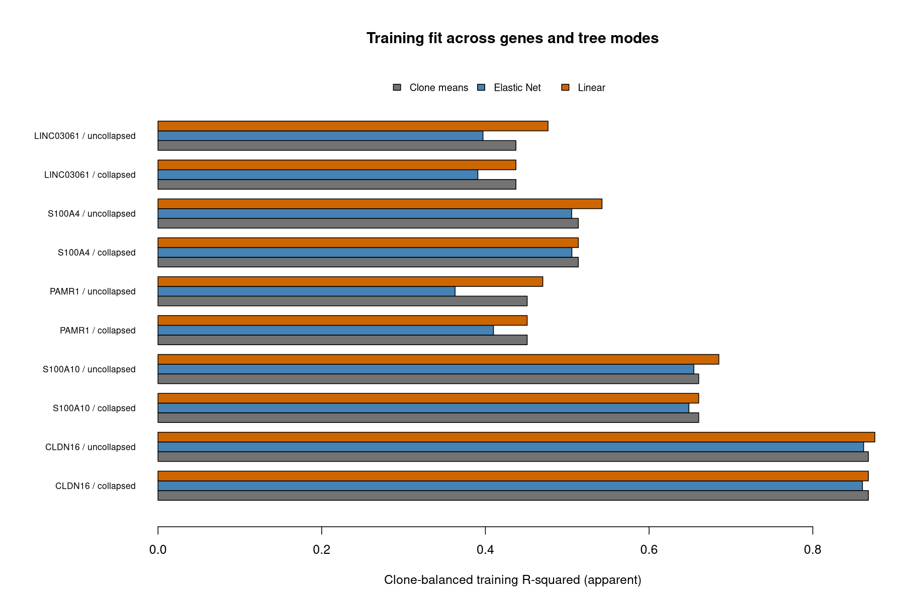

Bars compare apparent training fit within each gene. Higher training R-squared in a more flexible model is not evidence of better independent prediction. Genes can have different response scales and variability.

| gene | mode | status | EN_branches | EN_min_frequency | linear_gain | clone_delta_BIC |
| --- | --- | --- | --- | --- | --- | --- |
| CLDN16 | collapsed | complete |  2 | 1.00 | 0.000 | 0.000 |
| CLDN16 | uncollapsed | complete | 11 | 0.32 | 0.008 | 0.000 |
| S100A10 | collapsed | complete |  3 | 1.00 | 0.000 | 0.000 |
| S100A10 | uncollapsed | complete | 17 | 0.56 | 0.025 | 0.000 |
| PAMR1 | collapsed | complete |  1 | 1.00 | 0.000 | 14.458 |
| PAMR1 | uncollapsed | complete |  3 | 1.00 | 0.019 | 14.458 |
| S100A4 | collapsed | complete |  3 | 1.00 | 0.000 | 3.687 |
| S100A4 | uncollapsed | complete | 11 | 0.92 | 0.029 | 0.000 |
| LINC03061 | collapsed | complete |  1 | 1.00 | 0.000 | 14.640 |
| LINC03061 | uncollapsed | complete |  7 | 0.56 | 0.039 | 32.615 |

A positive clone delta BIC means an evaluated model has lower working BIC than full clone means; zero includes equivalent clone-mean parameterizations. It does not establish biological ancestry. The linear gain is the apparent R-squared difference from clone means, not an independent test.

## Comparison between tree modes

CLDN16 : uncollapsed minus collapsed apparent R-squared is 0.001 for EN and 0.008 for linear fitting. Full-fit selected EN branches: 2 collapsed versus 11 uncollapsed. These counts use different predictor dictionaries and do not count unique historical events.

S100A10 : uncollapsed minus collapsed apparent R-squared is 0.006 for EN and 0.025 for linear fitting. Full-fit selected EN branches: 3 collapsed versus 17 uncollapsed. These counts use different predictor dictionaries and do not count unique historical events.

PAMR1 : uncollapsed minus collapsed apparent R-squared is -0.047 for EN and 0.019 for linear fitting. Full-fit selected EN branches: 1 collapsed versus 3 uncollapsed. These counts use different predictor dictionaries and do not count unique historical events.

S100A4 : uncollapsed minus collapsed apparent R-squared is 0.000 for EN and 0.029 for linear fitting. Full-fit selected EN branches: 3 collapsed versus 11 uncollapsed. These counts use different predictor dictionaries and do not count unique historical events.

LINC03061 : uncollapsed minus collapsed apparent R-squared is 0.006 for EN and 0.039 for linear fitting. Full-fit selected EN branches: 1 collapsed versus 7 uncollapsed. These counts use different predictor dictionaries and do not count unique historical events.

Both modes use the same prepared response/cells and clone-balanced weights. Compare observed clone means and explicit contrast definitions; penalized coefficients can redistribute across nested branches and cannot be matched by size alone. IC searches differ between modes, so differing winning models need not indicate a contradiction.

## CLDN16

Selection reason: pilot anchor (CLDN16 when prepared; otherwise first available) .

Observed clone means range from 0.111 (Clone 3 ) to 3.768 (Clone 0 ). Overall detection is 94.5 percent. These are descriptive expression summaries, not ancestral changes.

| clone | cells | mean | detection_percent |
| --- | --- | --- | --- |
| 0 | 834 | 3.768 | 99.9 |
| 14 | 244 | 2.633 | 99.6 |
| 2 | 326 | 2.784 | 98.2 |
| 3 | 108 | 0.111 | 30.6 |

### collapsed

Validation settings: 100 subsamples; 80.0 percent per clone without replacement; EN alpha 0.5 and lambda.1se .

Training clone-balanced R-squared: clone means 0.868 ; Elastic Net 0.861 ; linear 0.868 . Linear minus clone means: 0.000 . Greater flexibility can improve training fit without improving independent prediction.

Elastic Net selected 2 branches in the full fit. Successful EN resamples: 100 of 100 . Linear resamples: 100 successful and 0 non-estimable. Contrast-specific usable resamples range from 100 to 100 . Read term-specific denominators; ranges below are not confidence intervals.

Largest full-fit selected EN contributions (up to ten; all branches are in the combined table):

| branch | coefficient | selected_fraction | successful | median | q05 | q95 |
| --- | --- | --- | --- | --- | --- | --- |
| branch_edge_1351 | -2.399 | 1.00 | 100 | -2.362 | -2.440 | -2.276 |
| branch_edge_3019 | 0.950 | 1.00 | 100 | 0.931 | 0.883 | 0.980 |

Lowest evaluated working BIC: branch_subset_16 = 2564.144 ; full clone-mean model delta BIC = 0.000 . Lowest evaluated AIC model: branch_subset_16 . Equivalent prediction spaces can have different branch names. This comparison is within this gene/mode; candidate searches may differ between modes.

Largest absolute descriptive contrasts (not an independent significance ranking):

| contrast | difference | usable | attempted |
| --- | --- | --- | --- |
| {3} vs {0,14,2} | -2.950 | 100 | 100 |
| {0} vs {14,2,3} | 1.925 | 100 | 100 |
| {2,3} vs {0,14} | -1.753 | 100 | 100 |

[Coefficients](../module07/CLDN16/CLDN16_collapsed_attempt1.coefficients.tsv) · [All contrast requests](../module07/CLDN16/CLDN16_collapsed_attempt1.contrasts.tsv) · [Stability](../module07/CLDN16/CLDN16_collapsed_validation_attempt1.stability.tsv) · [Iteration status](../module07/CLDN16/CLDN16_collapsed_validation_attempt1.iteration_status.tsv) · [Working IC](../module07/CLDN16/CLDN16_collapsed_validation_attempt1.model_comparison.tsv)

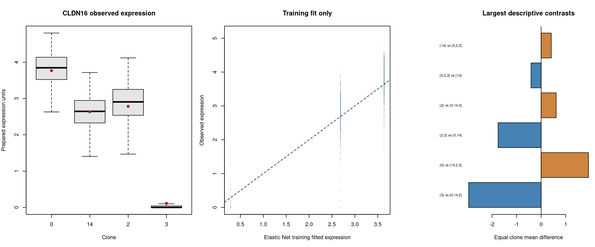

The comparison figure shows observed expression, training fits and descriptive contrasts; it is not independent validation.

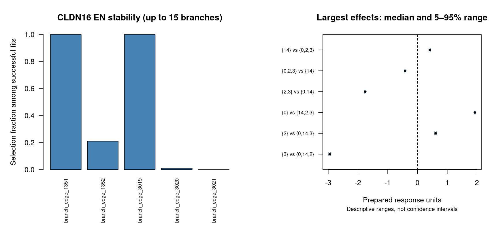

The stability figure shows selection frequencies and subsampling ranges. Ranges are not confidence intervals. Full tables retain terms omitted from plots.

[Collapsed selected clone tree](../module07/CLDN16/CLDN16_collapsed_attempt1.selected_tree.png)

Black branches are unselected; red/blue mark positive/negative simultaneous EN contributions. Labels identify original branch terms and coefficients. This topology view does not identify unique historical shifts.

### uncollapsed

Validation settings: 100 subsamples; 80.0 percent per clone without replacement; EN alpha 0.5 and lambda.1se .

Training clone-balanced R-squared: clone means 0.868 ; Elastic Net 0.862 ; linear 0.876 . Linear minus clone means: 0.008 . Greater flexibility can improve training fit without improving independent prediction.

Elastic Net selected 11 branches in the full fit. Successful EN resamples: 100 of 100 . Linear resamples: 91 successful and 9 non-estimable. Contrast-specific usable resamples range from 10 to 100 . Read term-specific denominators; ranges below are not confidence intervals.

Largest full-fit selected EN contributions (up to ten; all branches are in the combined table):

| branch | coefficient | selected_fraction | successful | median | q05 | q95 |
| --- | --- | --- | --- | --- | --- | --- |
| branch_edge_1351 | -1.808 | 1.00 | 100 | -1.652 | -1.848 | -1.361 |
| branch_edge_1350 | -0.481 | 1.00 | 100 | -0.542 | -0.710 | -0.438 |
| branch_edge_3019 | 0.374 | 1.00 | 100 | 0.326 | 0.270 | 0.388 |
| branch_edge_3017 | 0.220 | 1.00 | 100 | 0.214 | 0.175 | 0.263 |
| branch_edge_3015 | 0.186 | 1.00 | 100 | 0.177 | 0.133 | 0.227 |
| branch_edge_1339 | -0.176 | 1.00 | 100 | -0.242 | -0.336 | -0.147 |
| branch_edge_3011 | 0.132 | 1.00 | 100 | 0.122 | 0.080 | 0.165 |
| branch_edge_3007 | 0.042 | 0.92 | 100 | 0.029 | 0.000 | 0.067 |
| branch_edge_1119 | 0.041 | 0.32 | 100 | 0.000 | 0.000 | 0.059 |
| branch_edge_3013 | 0.039 | 0.96 | 100 | 0.060 | 0.002 | 0.102 |

Lowest evaluated working BIC: clone_means_reference = 2564.144 ; full clone-mean model delta BIC = 0.000 . Lowest evaluated AIC model: active_minus_branch_edge_1339 . Equivalent prediction spaces can have different branch names. This comparison is within this gene/mode; candidate searches may differ between modes.

Largest absolute descriptive contrasts (not an independent significance ranking):

| contrast | difference | usable | attempted |
| --- | --- | --- | --- |
| Clone 0: branch_edge_3015 / sister_within_clone | 0.413 |  54 | 100 |
| Clone 0: branch_edge_2743 / sister_within_clone | 0.362 | 100 | 100 |
| Clone 0: branch_edge_2744 / sister_within_clone | -0.362 | 100 | 100 |

All contrast requests: insufficient_cells=21; no_within_clone_split=664; ready=187 . Combined contrast table includes ready contrasts only; unavailable requests remain in the linked original table. No within-clone ancestry is established.

[Coefficients](../module07/CLDN16/CLDN16_uncollapsed_attempt1.coefficients.tsv) · [All contrast requests](../module07/CLDN16/CLDN16_uncollapsed_attempt1.contrasts.tsv) · [Stability](../module07/CLDN16/CLDN16_uncollapsed_validation_attempt1.stability.tsv) · [Iteration status](../module07/CLDN16/CLDN16_uncollapsed_validation_attempt1.iteration_status.tsv) · [Working IC](../module07/CLDN16/CLDN16_uncollapsed_validation_attempt1.model_comparison.tsv)

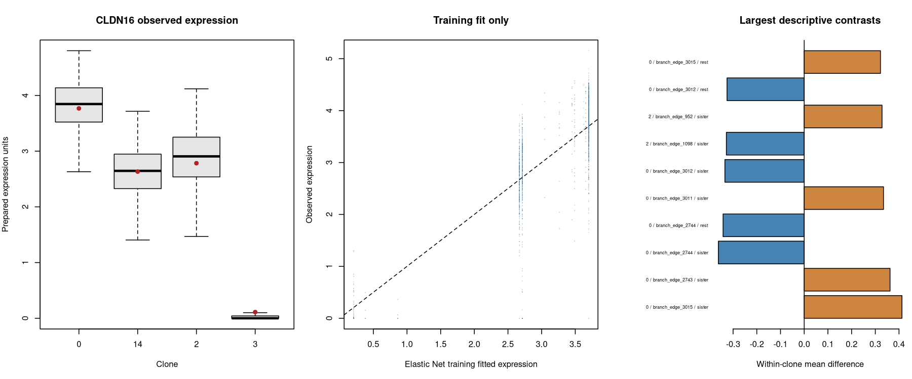

The comparison figure shows observed expression, training fits and descriptive contrasts; it is not independent validation.

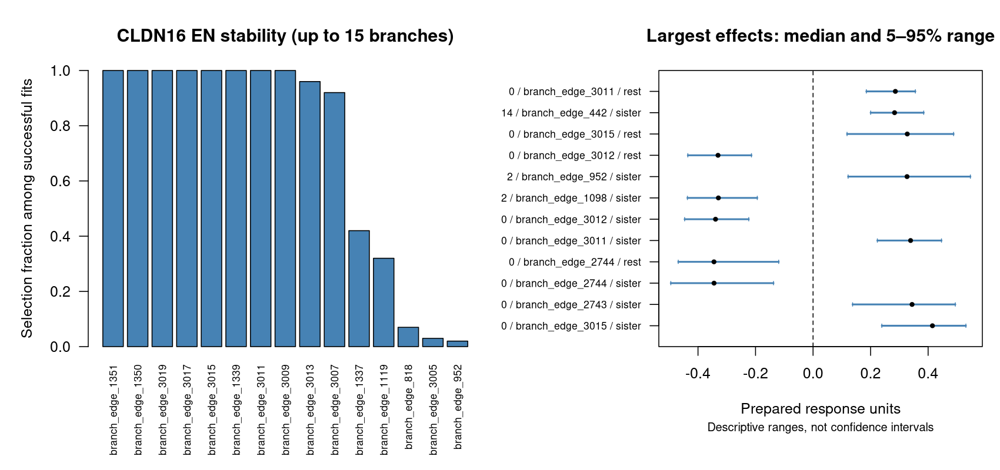

The stability figure shows selection frequencies and subsampling ranges. Ranges are not confidence intervals. Full tables retain terms omitted from plots.

[Exploratory selected cellular tree](../module07/CLDN16/CLDN16_uncollapsed_attempt1.selected_tree.png)

Black branches show the supplied cellular topology; red/blue mark positive/negative EN contributions. The tip strip identifies clones. Selection does not validate ancestry.

## S100A10

Selection reason: largest clone-mean range .

Observed clone means range from 0.136 (Clone 0 ) to 2.739 (Clone 2 ). Overall detection is 45.8 percent. These are descriptive expression summaries, not ancestral changes.

| clone | cells | mean | detection_percent |
| --- | --- | --- | --- |
| 0 | 834 | 0.136 | 15.7 |
| 14 | 244 | 1.240 | 68.0 |
| 2 | 326 | 2.739 | 98.8 |
| 3 | 108 | 0.454 | 67.6 |

### collapsed

Validation settings: 100 subsamples; 80.0 percent per clone without replacement; EN alpha 0.5 and lambda.1se .

Training clone-balanced R-squared: clone means 0.661 ; Elastic Net 0.649 ; linear 0.661 . Linear minus clone means: 0.000 . Greater flexibility can improve training fit without improving independent prediction.

Elastic Net selected 3 branches in the full fit. Successful EN resamples: 100 of 100 . Linear resamples: 100 successful and 0 non-estimable. Contrast-specific usable resamples range from 100 to 100 . Read term-specific denominators; ranges below are not confidence intervals.

Largest full-fit selected EN contributions (up to ten; all branches are in the combined table):

| branch | coefficient | selected_fraction | successful | median | q05 | q95 |
| --- | --- | --- | --- | --- | --- | --- |
| branch_edge_1352 | 1.443 | 1.00 | 100 | 1.445 | 1.391 | 1.501 |
| branch_edge_3019 | -0.859 | 1.00 | 100 | -0.841 | -0.918 | -0.748 |
| branch_edge_1351 | -0.552 | 1.00 | 100 | -0.533 | -0.610 | -0.415 |

Lowest evaluated working BIC: branch_subset_16 = 3014.070 ; full clone-mean model delta BIC = 0.000 . Lowest evaluated AIC model: branch_subset_16 . Equivalent prediction spaces can have different branch names. This comparison is within this gene/mode; candidate searches may differ between modes.

Largest absolute descriptive contrasts (not an independent significance ranking):

| contrast | difference | usable | attempted |
| --- | --- | --- | --- |
| {2} vs {0,14,3} | 2.129 | 100 | 100 |
| {0} vs {14,2,3} | -1.342 | 100 | 100 |
| {3} vs {0,14,2} | -0.918 | 100 | 100 |

[Coefficients](../module07/S100A10/S100A10_collapsed_attempt1.coefficients.tsv) · [All contrast requests](../module07/S100A10/S100A10_collapsed_attempt1.contrasts.tsv) · [Stability](../module07/S100A10/S100A10_collapsed_validation_attempt1.stability.tsv) · [Iteration status](../module07/S100A10/S100A10_collapsed_validation_attempt1.iteration_status.tsv) · [Working IC](../module07/S100A10/S100A10_collapsed_validation_attempt1.model_comparison.tsv)

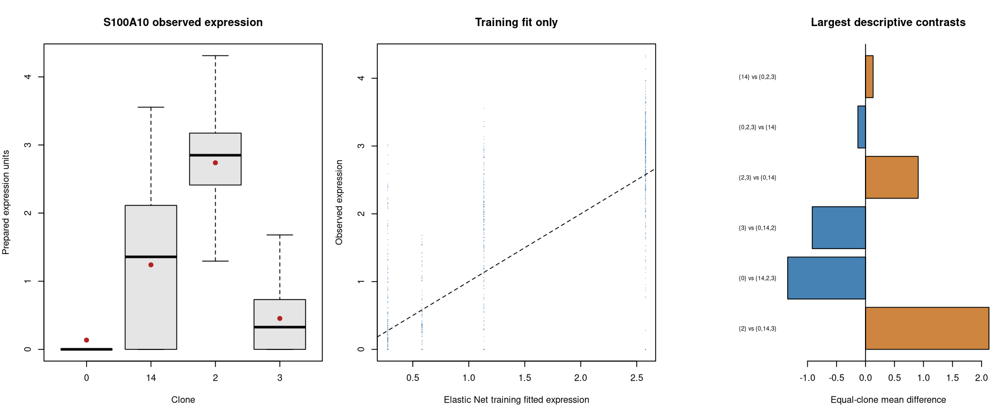

The comparison figure shows observed expression, training fits and descriptive contrasts; it is not independent validation.

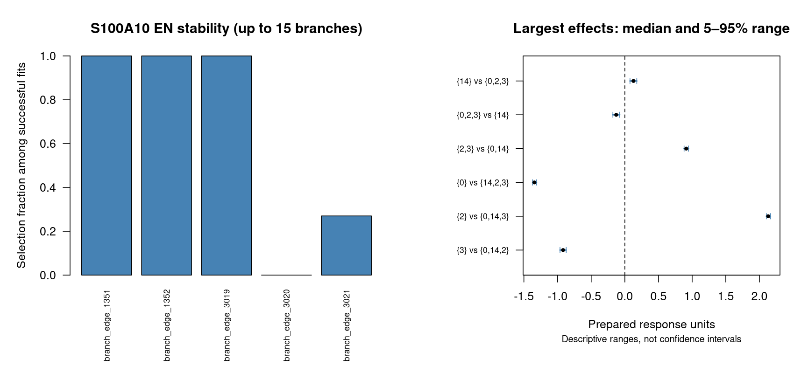

The stability figure shows selection frequencies and subsampling ranges. Ranges are not confidence intervals. Full tables retain terms omitted from plots.

[Collapsed selected clone tree](../module07/S100A10/S100A10_collapsed_attempt1.selected_tree.png)

Black branches are unselected; red/blue mark positive/negative simultaneous EN contributions. Labels identify original branch terms and coefficients. This topology view does not identify unique historical shifts.

### uncollapsed

Validation settings: 100 subsamples; 80.0 percent per clone without replacement; EN alpha 0.5 and lambda.1se .

Training clone-balanced R-squared: clone means 0.661 ; Elastic Net 0.655 ; linear 0.685 . Linear minus clone means: 0.025 . Greater flexibility can improve training fit without improving independent prediction.

Elastic Net selected 17 branches in the full fit. Successful EN resamples: 100 of 100 . Linear resamples: 91 successful and 9 non-estimable. Contrast-specific usable resamples range from 10 to 100 . Read term-specific denominators; ranges below are not confidence intervals.

Largest full-fit selected EN contributions (up to ten; all branches are in the combined table):

| branch | coefficient | selected_fraction | successful | median | q05 | q95 |
| --- | --- | --- | --- | --- | --- | --- |
| branch_edge_1352 | 0.518 | 1.00 | 100 | 0.499 | 0.402 | 0.623 |
| branch_edge_1134 | 0.361 | 1.00 | 100 | 0.354 | 0.293 | 0.406 |
| branch_edge_3019 | -0.304 | 1.00 | 100 | -0.278 | -0.333 | -0.225 |
| branch_edge_1124 | 0.292 | 1.00 | 100 | 0.285 | 0.233 | 0.339 |
| branch_edge_1350 | -0.254 | 1.00 | 100 | -0.217 | -0.314 | -0.148 |
| branch_edge_1135 | 0.250 | 1.00 | 100 | 0.258 | 0.180 | 0.359 |
| branch_edge_3017 | -0.202 | 1.00 | 100 | -0.187 | -0.219 | -0.151 |
| branch_edge_1351 | -0.198 | 1.00 | 100 | -0.164 | -0.243 | -0.089 |
| branch_edge_3015 | -0.139 | 1.00 | 100 | -0.129 | -0.162 | -0.107 |
| branch_edge_1119 | 0.136 | 0.99 | 100 | 0.139 | 0.080 | 0.218 |

Lowest evaluated working BIC: clone_means_reference = 3014.070 ; full clone-mean model delta BIC = 0.000 . Lowest evaluated AIC model: active_minus_branch_edge_1124 . Equivalent prediction spaces can have different branch names. This comparison is within this gene/mode; candidate searches may differ between modes.

Largest absolute descriptive contrasts (not an independent significance ranking):

| contrast | difference | usable | attempted |
| --- | --- | --- | --- |
| Clone 14: branch_edge_67 / sister_within_clone | -0.993 | 12 | 100 |
| Clone 2: branch_edge_1134 / within_clone | 0.879 | 87 | 100 |
| Clone 2: branch_edge_1124 / within_clone | 0.769 | 98 | 100 |

All contrast requests: insufficient_cells=21; no_within_clone_split=664; ready=187 . Combined contrast table includes ready contrasts only; unavailable requests remain in the linked original table. No within-clone ancestry is established.

[Coefficients](../module07/S100A10/S100A10_uncollapsed_attempt1.coefficients.tsv) · [All contrast requests](../module07/S100A10/S100A10_uncollapsed_attempt1.contrasts.tsv) · [Stability](../module07/S100A10/S100A10_uncollapsed_validation_attempt1.stability.tsv) · [Iteration status](../module07/S100A10/S100A10_uncollapsed_validation_attempt1.iteration_status.tsv) · [Working IC](../module07/S100A10/S100A10_uncollapsed_validation_attempt1.model_comparison.tsv)

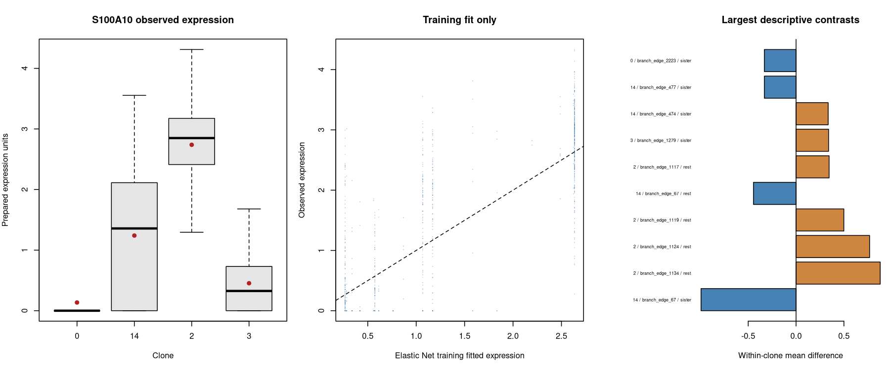

The comparison figure shows observed expression, training fits and descriptive contrasts; it is not independent validation.

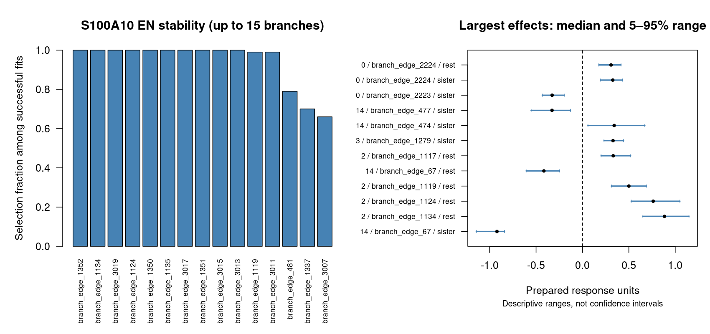

The stability figure shows selection frequencies and subsampling ranges. Ranges are not confidence intervals. Full tables retain terms omitted from plots.

[Exploratory selected cellular tree](../module07/S100A10/S100A10_uncollapsed_attempt1.selected_tree.png)

Black branches show the supplied cellular topology; red/blue mark positive/negative EN contributions. The tip strip identifies clones. Selection does not validate ancestry.

## PAMR1

Selection reason: lowest detection fraction .

Observed clone means range from 0.001 (Clone 2 ) to 0.616 (Clone 3 ). Overall detection is 6.2 percent. These are descriptive expression summaries, not ancestral changes.

| clone | cells | mean | detection_percent |
| --- | --- | --- | --- |
| 0 | 834 | 0.005 | 1.6 |
| 14 | 244 | 0.007 | 2.0 |
| 2 | 326 | 0.001 | 0.6 |
| 3 | 108 | 0.616 | 68.5 |

### collapsed

Validation settings: 100 subsamples; 80.0 percent per clone without replacement; EN alpha 0.5 and lambda.1se .

Training clone-balanced R-squared: clone means 0.451 ; Elastic Net 0.410 ; linear 0.451 . Linear minus clone means: 0.000 . Greater flexibility can improve training fit without improving independent prediction.

Elastic Net selected 1 branches in the full fit. Successful EN resamples: 100 of 100 . Linear resamples: 100 successful and 0 non-estimable. Contrast-specific usable resamples range from 100 to 100 . Read term-specific denominators; ranges below are not confidence intervals.

Largest full-fit selected EN contributions (up to ten; all branches are in the combined table):

| branch | coefficient | selected_fraction | successful | median | q05 | q95 |
| --- | --- | --- | --- | --- | --- | --- |
| branch_edge_1351 | 0.427 | 1.00 | 100 | 0.376 | 0.288 | 0.474 |

Lowest evaluated working BIC: branch_subset_1 = -1166.018 ; full clone-mean model delta BIC = 14.458 . Lowest evaluated AIC model: branch_subset_1 . Equivalent prediction spaces can have different branch names. This comparison is within this gene/mode; candidate searches may differ between modes.

Largest absolute descriptive contrasts (not an independent significance ranking):

| contrast | difference | usable | attempted |
| --- | --- | --- | --- |
| {3} vs {0,14,2} | 0.612 | 100 | 100 |
| {2,3} vs {0,14} | 0.303 | 100 | 100 |
| {2} vs {0,14,3} | -0.208 | 100 | 100 |

[Coefficients](../module07/PAMR1/PAMR1_collapsed_attempt1.coefficients.tsv) · [All contrast requests](../module07/PAMR1/PAMR1_collapsed_attempt1.contrasts.tsv) · [Stability](../module07/PAMR1/PAMR1_collapsed_validation_attempt1.stability.tsv) · [Iteration status](../module07/PAMR1/PAMR1_collapsed_validation_attempt1.iteration_status.tsv) · [Working IC](../module07/PAMR1/PAMR1_collapsed_validation_attempt1.model_comparison.tsv)

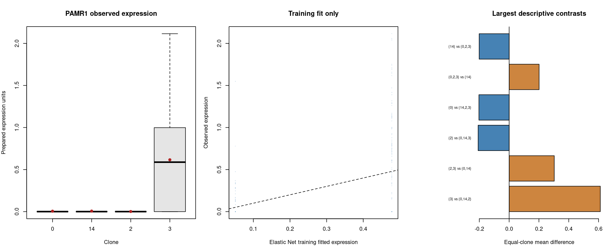

The comparison figure shows observed expression, training fits and descriptive contrasts; it is not independent validation.

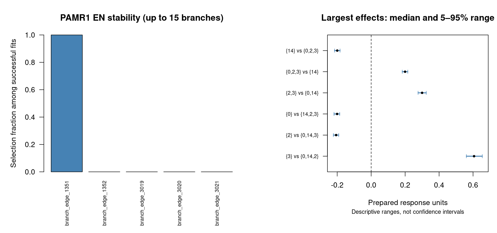

The stability figure shows selection frequencies and subsampling ranges. Ranges are not confidence intervals. Full tables retain terms omitted from plots.

[Collapsed selected clone tree](../module07/PAMR1/PAMR1_collapsed_attempt1.selected_tree.png)

Black branches are unselected; red/blue mark positive/negative simultaneous EN contributions. Labels identify original branch terms and coefficients. This topology view does not identify unique historical shifts.

### uncollapsed

Validation settings: 100 subsamples; 80.0 percent per clone without replacement; EN alpha 0.5 and lambda.1se .

Training clone-balanced R-squared: clone means 0.451 ; Elastic Net 0.363 ; linear 0.470 . Linear minus clone means: 0.019 . Greater flexibility can improve training fit without improving independent prediction.

Elastic Net selected 3 branches in the full fit. Successful EN resamples: 100 of 100 . Linear resamples: 91 successful and 9 non-estimable. Contrast-specific usable resamples range from 10 to 100 . Read term-specific denominators; ranges below are not confidence intervals.

Largest full-fit selected EN contributions (up to ten; all branches are in the combined table):

| branch | coefficient | selected_fraction | successful | median | q05 | q95 |
| --- | --- | --- | --- | --- | --- | --- |
| branch_edge_1351 | 0.188 | 1.00 | 100 | 0.179 | 0.121 | 0.252 |
| branch_edge_1350 | 0.093 | 1.00 | 100 | 0.086 | 0.057 | 0.138 |
| branch_edge_1339 | 0.076 | 1.00 | 100 | 0.071 | 0.042 | 0.114 |

Lowest evaluated working BIC: single_47 = -1166.018 ; full clone-mean model delta BIC = 14.458 . Lowest evaluated AIC model: single_47 . Equivalent prediction spaces can have different branch names. This comparison is within this gene/mode; candidate searches may differ between modes.

Largest absolute descriptive contrasts (not an independent significance ranking):

| contrast | difference | usable | attempted |
| --- | --- | --- | --- |
| Clone 3: branch_edge_1337 / within_clone | -0.161 |  89 | 100 |
| Clone 3: branch_edge_1279 / sister_within_clone | -0.139 |  52 | 100 |
| Clone 3: branch_edge_1279 / within_clone | -0.136 | 100 | 100 |

All contrast requests: insufficient_cells=21; no_within_clone_split=664; ready=187 . Combined contrast table includes ready contrasts only; unavailable requests remain in the linked original table. No within-clone ancestry is established.

[Coefficients](../module07/PAMR1/PAMR1_uncollapsed_attempt1.coefficients.tsv) · [All contrast requests](../module07/PAMR1/PAMR1_uncollapsed_attempt1.contrasts.tsv) · [Stability](../module07/PAMR1/PAMR1_uncollapsed_validation_attempt1.stability.tsv) · [Iteration status](../module07/PAMR1/PAMR1_uncollapsed_validation_attempt1.iteration_status.tsv) · [Working IC](../module07/PAMR1/PAMR1_uncollapsed_validation_attempt1.model_comparison.tsv)

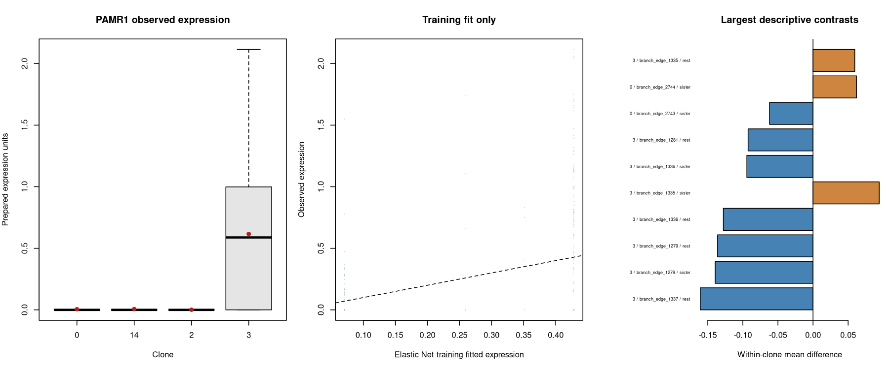

The comparison figure shows observed expression, training fits and descriptive contrasts; it is not independent validation.

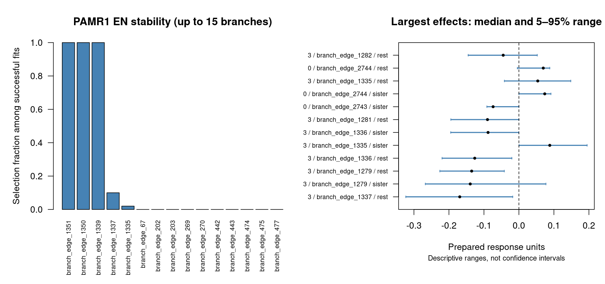

The stability figure shows selection frequencies and subsampling ranges. Ranges are not confidence intervals. Full tables retain terms omitted from plots.

[Exploratory selected cellular tree](../module07/PAMR1/PAMR1_uncollapsed_attempt1.selected_tree.png)

Black branches show the supplied cellular topology; red/blue mark positive/negative EN contributions. The tip strip identifies clones. Selection does not validate ancestry.

## S100A4

Selection reason: highest detection fraction .

Observed clone means range from 0.259 (Clone 3 ) to 2.643 (Clone 0 ). Overall detection is 94.8 percent. These are descriptive expression summaries, not ancestral changes.

| clone | cells | mean | detection_percent |
| --- | --- | --- | --- |
| 0 | 834 | 2.643 | 98.3 |
| 14 | 244 | 1.597 | 96.3 |
| 2 | 326 | 1.448 | 95.7 |
| 3 | 108 | 0.259 | 62.0 |

### collapsed

Validation settings: 100 subsamples; 80.0 percent per clone without replacement; EN alpha 0.5 and lambda.1se .

Training clone-balanced R-squared: clone means 0.514 ; Elastic Net 0.506 ; linear 0.514 . Linear minus clone means: 0.000 . Greater flexibility can improve training fit without improving independent prediction.

Elastic Net selected 3 branches in the full fit. Successful EN resamples: 100 of 100 . Linear resamples: 100 successful and 0 non-estimable. Contrast-specific usable resamples range from 100 to 100 . Read term-specific denominators; ranges below are not confidence intervals.

Largest full-fit selected EN contributions (up to ten; all branches are in the combined table):

| branch | coefficient | selected_fraction | successful | median | q05 | q95 |
| --- | --- | --- | --- | --- | --- | --- |
| branch_edge_1351 | -1.024 | 1.00 | 100 | -0.945 | -1.021 | -0.868 |
| branch_edge_3019 | 0.892 | 1.00 | 100 | 0.811 | 0.738 | 0.903 |
| branch_edge_3020 | -0.174 | 1.00 | 100 | -0.176 | -0.219 | -0.119 |

Lowest evaluated working BIC: branch_subset_7 = 4084.846 ; full clone-mean model delta BIC = 3.687 . Lowest evaluated AIC model: branch_subset_16 . Equivalent prediction spaces can have different branch names. This comparison is within this gene/mode; candidate searches may differ between modes.

Largest absolute descriptive contrasts (not an independent significance ranking):

| contrast | difference | usable | attempted |
| --- | --- | --- | --- |
| {3} vs {0,14,2} | -1.637 | 100 | 100 |
| {0} vs {14,2,3} | 1.542 | 100 | 100 |
| {2,3} vs {0,14} | -1.267 | 100 | 100 |

[Coefficients](../module07/S100A4/S100A4_collapsed_attempt1.coefficients.tsv) · [All contrast requests](../module07/S100A4/S100A4_collapsed_attempt1.contrasts.tsv) · [Stability](../module07/S100A4/S100A4_collapsed_validation_attempt1.stability.tsv) · [Iteration status](../module07/S100A4/S100A4_collapsed_validation_attempt1.iteration_status.tsv) · [Working IC](../module07/S100A4/S100A4_collapsed_validation_attempt1.model_comparison.tsv)

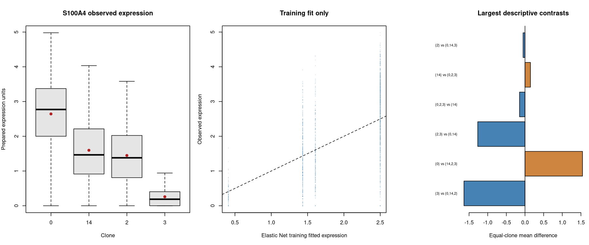

The comparison figure shows observed expression, training fits and descriptive contrasts; it is not independent validation.

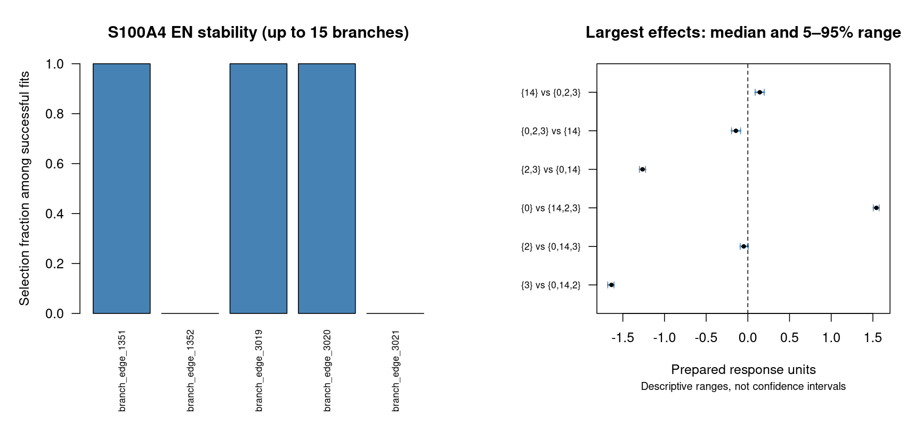

The stability figure shows selection frequencies and subsampling ranges. Ranges are not confidence intervals. Full tables retain terms omitted from plots.

[Collapsed selected clone tree](../module07/S100A4/S100A4_collapsed_attempt1.selected_tree.png)

Black branches are unselected; red/blue mark positive/negative simultaneous EN contributions. Labels identify original branch terms and coefficients. This topology view does not identify unique historical shifts.

### uncollapsed

Validation settings: 100 subsamples; 80.0 percent per clone without replacement; EN alpha 0.5 and lambda.1se .

Training clone-balanced R-squared: clone means 0.514 ; Elastic Net 0.505 ; linear 0.542 . Linear minus clone means: 0.029 . Greater flexibility can improve training fit without improving independent prediction.

Elastic Net selected 11 branches in the full fit. Successful EN resamples: 100 of 100 . Linear resamples: 91 successful and 9 non-estimable. Contrast-specific usable resamples range from 10 to 100 . Read term-specific denominators; ranges below are not confidence intervals.

Largest full-fit selected EN contributions (up to ten; all branches are in the combined table):

| branch | coefficient | selected_fraction | successful | median | q05 | q95 |
| --- | --- | --- | --- | --- | --- | --- |
| branch_edge_1351 | -0.604 | 1.00 | 100 | -0.546 | -0.639 | -0.460 |
| branch_edge_1350 | -0.289 | 1.00 | 100 | -0.278 | -0.335 | -0.233 |
| branch_edge_3009 | 0.214 | 1.00 | 100 | 0.192 | 0.143 | 0.237 |
| branch_edge_3015 | 0.179 | 1.00 | 100 | 0.166 | 0.130 | 0.206 |
| branch_edge_3019 | 0.169 | 1.00 | 100 | 0.161 | 0.112 | 0.201 |
| branch_edge_3017 | 0.159 | 1.00 | 100 | 0.150 | 0.103 | 0.195 |
| branch_edge_3011 | 0.134 | 1.00 | 100 | 0.124 | 0.096 | 0.173 |
| branch_edge_3020 | -0.126 | 1.00 | 100 | -0.110 | -0.160 | -0.057 |
| branch_edge_1339 | -0.125 | 1.00 | 100 | -0.130 | -0.176 | -0.089 |
| branch_edge_3013 | 0.052 | 0.98 | 100 | 0.057 | 0.012 | 0.116 |

Lowest evaluated working BIC: clone_means_reference = 4088.533 ; full clone-mean model delta BIC = 0.000 . Lowest evaluated AIC model: active_minus_branch_edge_1339 . Equivalent prediction spaces can have different branch names. This comparison is within this gene/mode; candidate searches may differ between modes.

Largest absolute descriptive contrasts (not an independent significance ranking):

| contrast | difference | usable | attempted |
| --- | --- | --- | --- |
| Clone 0: branch_edge_3015 / sister_within_clone | 0.790 |  54 | 100 |
| Clone 0: branch_edge_3015 / within_clone | 0.779 | 100 | 100 |
| Clone 0: branch_edge_3011 / sister_within_clone | 0.620 | 100 | 100 |

All contrast requests: insufficient_cells=21; no_within_clone_split=664; ready=187 . Combined contrast table includes ready contrasts only; unavailable requests remain in the linked original table. No within-clone ancestry is established.

[Coefficients](../module07/S100A4/S100A4_uncollapsed_attempt1.coefficients.tsv) · [All contrast requests](../module07/S100A4/S100A4_uncollapsed_attempt1.contrasts.tsv) · [Stability](../module07/S100A4/S100A4_uncollapsed_validation_attempt1.stability.tsv) · [Iteration status](../module07/S100A4/S100A4_uncollapsed_validation_attempt1.iteration_status.tsv) · [Working IC](../module07/S100A4/S100A4_uncollapsed_validation_attempt1.model_comparison.tsv)

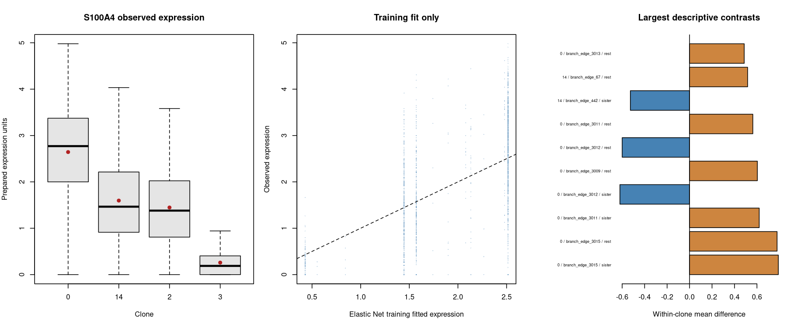

The comparison figure shows observed expression, training fits and descriptive contrasts; it is not independent validation.

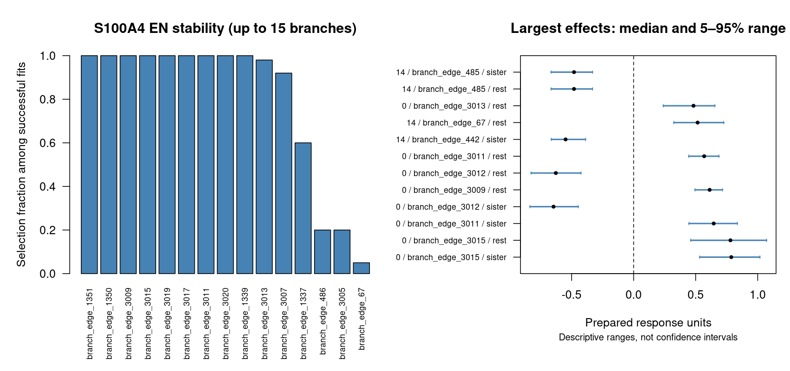

The stability figure shows selection frequencies and subsampling ranges. Ranges are not confidence intervals. Full tables retain terms omitted from plots.

[Exploratory selected cellular tree](../module07/S100A4/S100A4_uncollapsed_attempt1.selected_tree.png)

Black branches show the supplied cellular topology; red/blue mark positive/negative EN contributions. The tip strip identifies clones. Selection does not validate ancestry.

## LINC03061

Selection reason: smallest clone-mean range among prepared genes .

Observed clone means range from 0.003 (Clone 14 ) to 0.365 (Clone 2 ). Overall detection is 16.0 percent. These are descriptive expression summaries, not ancestral changes.

| clone | cells | mean | detection_percent |
| --- | --- | --- | --- |
| 0 | 834 | 0.003 | 1.4 |
| 14 | 244 | 0.003 | 1.6 |
| 2 | 326 | 0.365 | 69.0 |
| 3 | 108 | 0.004 | 0.9 |

### collapsed

Validation settings: 100 subsamples; 80.0 percent per clone without replacement; EN alpha 0.5 and lambda.1se .

Training clone-balanced R-squared: clone means 0.437 ; Elastic Net 0.391 ; linear 0.437 . Linear minus clone means: 0.000 . Greater flexibility can improve training fit without improving independent prediction.

Elastic Net selected 1 branches in the full fit. Successful EN resamples: 100 of 100 . Linear resamples: 100 successful and 0 non-estimable. Contrast-specific usable resamples range from 100 to 100 . Read term-specific denominators; ranges below are not confidence intervals.

Largest full-fit selected EN contributions (up to ten; all branches are in the combined table):

| branch | coefficient | selected_fraction | successful | median | q05 | q95 |
| --- | --- | --- | --- | --- | --- | --- |
| branch_edge_1352 | 0.244 | 1.00 | 100 | 0.246 | 0.207 | 0.280 |

Lowest evaluated working BIC: branch_subset_2 = -1134.711 ; full clone-mean model delta BIC = 14.640 . Lowest evaluated AIC model: branch_subset_2 . Equivalent prediction spaces can have different branch names. This comparison is within this gene/mode; candidate searches may differ between modes.

Largest absolute descriptive contrasts (not an independent significance ranking):

| contrast | difference | usable | attempted |
| --- | --- | --- | --- |
| {2} vs {0,14,3} | 0.361 | 100 | 100 |
| {2,3} vs {0,14} | 0.181 | 100 | 100 |
| {0,2,3} vs {14} | 0.121 | 100 | 100 |

[Coefficients](../module07/LINC03061/LINC03061_collapsed_attempt1.coefficients.tsv) · [All contrast requests](../module07/LINC03061/LINC03061_collapsed_attempt1.contrasts.tsv) · [Stability](../module07/LINC03061/LINC03061_collapsed_validation_attempt1.stability.tsv) · [Iteration status](../module07/LINC03061/LINC03061_collapsed_validation_attempt1.iteration_status.tsv) · [Working IC](../module07/LINC03061/LINC03061_collapsed_validation_attempt1.model_comparison.tsv)

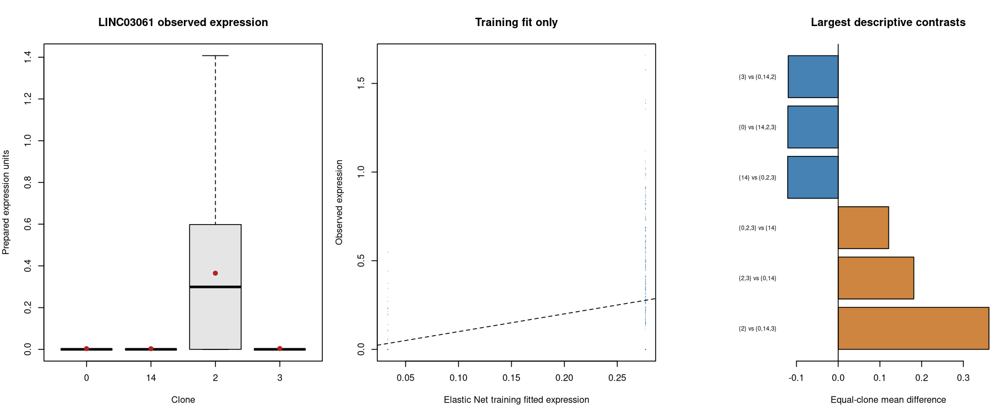

The comparison figure shows observed expression, training fits and descriptive contrasts; it is not independent validation.

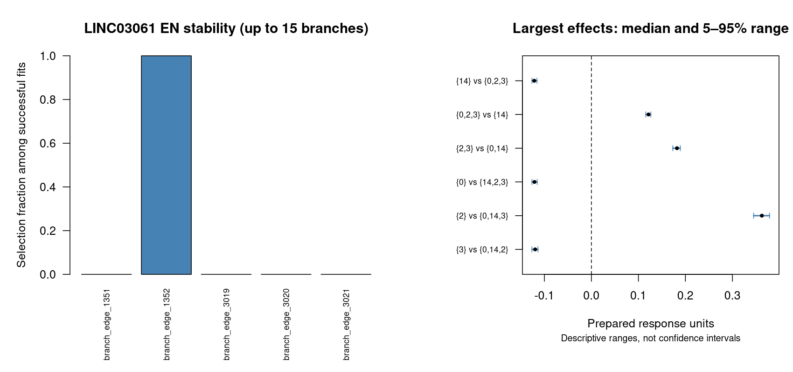

The stability figure shows selection frequencies and subsampling ranges. Ranges are not confidence intervals. Full tables retain terms omitted from plots.

[Collapsed selected clone tree](../module07/LINC03061/LINC03061_collapsed_attempt1.selected_tree.png)

Black branches are unselected; red/blue mark positive/negative simultaneous EN contributions. Labels identify original branch terms and coefficients. This topology view does not identify unique historical shifts.

### uncollapsed

Validation settings: 100 subsamples; 80.0 percent per clone without replacement; EN alpha 0.5 and lambda.1se .

Training clone-balanced R-squared: clone means 0.437 ; Elastic Net 0.397 ; linear 0.477 . Linear minus clone means: 0.039 . Greater flexibility can improve training fit without improving independent prediction.

Elastic Net selected 7 branches in the full fit. Successful EN resamples: 100 of 100 . Linear resamples: 91 successful and 9 non-estimable. Contrast-specific usable resamples range from 10 to 100 . Read term-specific denominators; ranges below are not confidence intervals.

Largest full-fit selected EN contributions (up to ten; all branches are in the combined table):

| branch | coefficient | selected_fraction | successful | median | q05 | q95 |
| --- | --- | --- | --- | --- | --- | --- |
| branch_edge_1134 | 0.061 | 1.00 | 100 | 0.060 | 0.044 | 0.073 |
| branch_edge_1352 | 0.059 | 1.00 | 100 | 0.058 | 0.040 | 0.077 |
| branch_edge_1135 | 0.052 | 1.00 | 100 | 0.051 | 0.037 | 0.064 |
| branch_edge_1124 | 0.043 | 1.00 | 100 | 0.042 | 0.031 | 0.054 |
| branch_edge_1099 | 0.018 | 0.93 | 100 | 0.015 | 0.000 | 0.035 |
| branch_edge_1119 | 0.017 | 0.97 | 100 | 0.016 | 0.003 | 0.028 |
| branch_edge_1116 | 0.002 | 0.56 | 100 | 0.001 | 0.000 | 0.014 |

Lowest evaluated working BIC: single_37 = -1152.687 ; full clone-mean model delta BIC = 32.615 . Lowest evaluated AIC model: active_minus_branch_edge_1135 . Equivalent prediction spaces can have different branch names. This comparison is within this gene/mode; candidate searches may differ between modes.

Largest absolute descriptive contrasts (not an independent significance ranking):

| contrast | difference | usable | attempted |
| --- | --- | --- | --- |
| Clone 2: branch_edge_1134 / within_clone | 0.236 |  87 | 100 |
| Clone 2: branch_edge_813 / sister_within_clone | 0.179 | 100 | 100 |
| Clone 2: branch_edge_814 / sister_within_clone | -0.179 | 100 | 100 |

All contrast requests: insufficient_cells=21; no_within_clone_split=664; ready=187 . Combined contrast table includes ready contrasts only; unavailable requests remain in the linked original table. No within-clone ancestry is established.

[Coefficients](../module07/LINC03061/LINC03061_uncollapsed_attempt1.coefficients.tsv) · [All contrast requests](../module07/LINC03061/LINC03061_uncollapsed_attempt1.contrasts.tsv) · [Stability](../module07/LINC03061/LINC03061_uncollapsed_validation_attempt1.stability.tsv) · [Iteration status](../module07/LINC03061/LINC03061_uncollapsed_validation_attempt1.iteration_status.tsv) · [Working IC](../module07/LINC03061/LINC03061_uncollapsed_validation_attempt1.model_comparison.tsv)

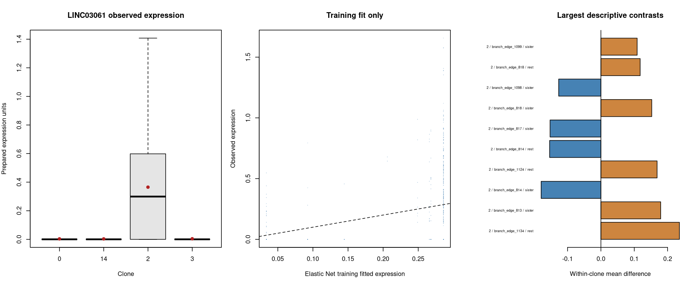

The comparison figure shows observed expression, training fits and descriptive contrasts; it is not independent validation.

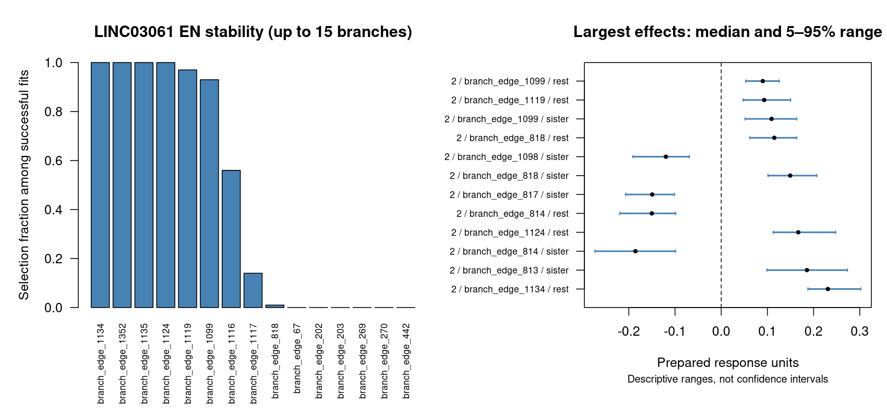

The stability figure shows selection frequencies and subsampling ranges. Ranges are not confidence intervals. Full tables retain terms omitted from plots.

[Exploratory selected cellular tree](../module07/LINC03061/LINC03061_uncollapsed_attempt1.selected_tree.png)

Black branches show the supplied cellular topology; red/blue mark positive/negative EN contributions. The tip strip identifies clones. Selection does not validate ancestry.

## Traceability and reading the tables

Panel source: 
[Module 7 panel](../module07/module07.panel.tsv)
[Module 7 stage history](../module07/module07.status.tsv)

[Gene/mode overview](module08.gene_summary.tsv)
[Training metrics](module08.fit_metrics.tsv)
[All branch stability estimates](module08.branch_stability.tsv)
[Ready contrasts](module08.contrasts.tsv)
[Source hashes](module08.sources.tsv)

[Column definitions and worked examples](../../docs/RESULTS_GUIDE.md)

Keep this report with the input panel folders so relative figure/table links work.

